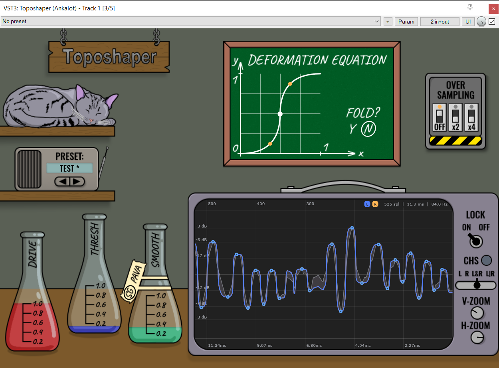

# Toposhaper


A topological waveshaper. It detects persistent extrema in the incoming
signal, turns them into anchors/seams that split the stream into sections,
then smooths and warps each section interior with a user-drawn deformation
curve while the anchors stay pinned.

## Features

- Deformation curve editor
- Extrema threshold: keep fine detail or demote noise to texture
- Section smoothing: Savitzky-Golay denoise or PAVA isotonic monotonization
- Oversampling OFF / X2 / X4
- Built-in scope: triggered or scrolling view, ghost input trace, anchor
  markers, L / R / L+R / L|R channel modes

## How to get it?
Go to the Releases tab and download the build for your OS and plugin format.
Put it into your DAW's plugin folder and rescan, or add the folder to the
DAW's plugin search paths.

## How to build from source?

Requirements:

- C++23 compiler (MSVC 2022, clang 16+, gcc 13+)
- CMake 3.24+
- Git
- Internet access on the first configure only: CPM downloads JUCE and
  GoogleTest automatically, no manual JUCE installation is needed

Use the `.bat` scripts in the repo root, or run:  
Debug:
```bash
cmake --preset default   # configure
cmake --build --preset default
ctest --preset default   # test
```
Release:
```bash
cmake --preset release   # configure
cmake --build --preset release
ctest --preset release   # test
```

## License

This project is licensed under the [GNU General Public License v3.0](LICENSE).  
JUCE and GoogleTest are fetched by CPM and remain under their own licenses.